# Justificación de la arquitectura y de las tecnologías

Este documento explica **por qué** SportBet está construido como está: el estilo arquitectónico, los patrones y cada tecnología. Para cada uno se indica qué alternativas se consideraron y por qué se descartaron.

- **Decisiones puntuales:** en los ADR ([0001](../adr/0001-decisiones-base.md), [0002](../adr/0002-decisiones-integracion.md)).
- **Evaluación de la arquitectura:** en [evaluacion-atam.md](evaluacion-atam.md).

## 1. Contexto y factores que guían la arquitectura

**El problema.** Una casa de apuestas deportivas con dinero virtual:
- los usuarios ven partidos reales;
- apuestan con cuotas que calcula el sistema;
- siguen el marcador en vivo;
- cobran automáticamente cuando el partido termina.

**Atributos de calidad prioritarios** (el detalle y la medición están en el ATAM):

| # | Atributo | Por qué importa en este dominio |
|---|---|---|
| 1 | **Integridad del dinero** | Un doble cobro o un pago doble invalida el producto, aunque el dinero sea virtual |
| 2 | **Disponibilidad ante fallas del proveedor externo** | API-Football puede caerse o agotar su cuota; la app debe seguir funcionando |
| 3 | **Frescura del dato en vivo** | El marcador y la línea de tiempo son el atractivo del producto |
| 4 | **Seguridad** | Cuentas, sesiones y roles de administrador |
| 5 | **Modificabilidad** | Cambiar de proveedor de datos o agregar mercados sin rehacer el sistema |
| 6 | **Rendimiento** | Respuestas rápidas al navegar y al apostar |

**Restricciones** (no negociables):

| Restricción | Consecuencia en el diseño |
|---|---|
| 4 personas, 5 días (8–13 oct 2026) | Arquitectura simple de operar; módulos con un solo dueño para trabajar en paralelo sin conflictos |
| API-Football gratuita: 100 llamadas al día y 10 por minuto | Un único componente consulta al proveedor; los usuarios nunca generan llamadas externas |
| Curso de arquitectura | Patrones explícitos, decisiones documentadas y reglas verificables |
| Sin presupuesto de infraestructura | Todo corre en una máquina con Docker |

## 2. Estilo arquitectónico: monolito modular en capas con inversión de dependencias

```mermaid
flowchart TB
    subgraph Navegador
        NG[Angular 22]
    end
    subgraph "API (un proceso Go)"
        direction LR
        A[auth] ~~~ U[users] ~~~ AD[admin]
        E[events] ~~~ M[markets] ~~~ P[providers]
        B[betting] ~~~ W[wallet] ~~~ S[settlement]
        SH[[shared: contratos · bus · dinero · db]]
    end
    PG[(PostgreSQL 17)]
    AF[API-Football / replay]
    NG -- REST + JWT / SSE --> A & E & B
    A & E & B & W & S & U & AD & M & P --> SH
    SH --> PG
    P -- solo el Sync Worker --> AF
```

**Qué es:**
- **Un solo binario** con 9 módulos de negocio.
- **Cuatro capas por módulo:** `domain` → `application` → `infrastructure` / `presentation`. Las dependencias apuntan **hacia el dominio**: las interfaces viven en `domain` y `application`, y la infraestructura las implementa.
- **Sin dependencias entre módulos:** se comunican por interfaces de `shared/contracts` (que `main.go` inyecta) y por un bus de eventos en memoria.

**Por qué:**

| Necesidad | Cómo la cubre el estilo |
|---|---|
| Apostar y debitar en **una sola transacción** | Un único proceso y una base: la transacción de PostgreSQL basta, sin sagas ni 2PC |
| Trabajar en paralelo 4 personas sin pisarse | Un directorio por módulo y un dueño por directorio (`CODEOWNERS`); los contratos se fijaron el día 1 con fakes |
| Cambiar el proveedor o la base sin tocar las reglas | Inversión de dependencias: el dominio no conoce pgx, HTTP ni API-Football |
| Que las reglas no se rompan con el tiempo | `scripts/check-imports.sh` hace fallar el CI si un módulo importa a otro o si un `domain` importa infraestructura |

**Alternativas descartadas:**

| Alternativa | Por qué no |
|---|---|
| **Microservicios** (un servicio por módulo) | Apuesta + débito exigirían transacciones distribuidas (saga u outbox). Además: más despliegues, red entre servicios y observabilidad distribuida para 4 personas en 5 días. Su beneficio (escalar por separado) no hace falta: la prueba de carga da 232 req/s con 200 usuarios en una máquina |
| **Capas "clásicas" globales** (`domain/`, `application/` en la raíz), como la propuesta original | El diagrama original tenía Dominio → PostgreSQL y Dominio → Adapter (dependencia hacia la infraestructura). Además, carpetas globales compartidas por todos multiplican los conflictos de git |
| **MVC simple sin capas** | Las reglas de dinero quedarían mezcladas con SQL y HTTP, difíciles de probar y de razonar |
| **Serverless / BaaS** (Firebase, Supabase) | Sin control de la transacción de débito; el worker de sincronización y el SSE no encajan en funciones efímeras |

## 3. Patrones de diseño

| Patrón | Dónde | Qué resuelve |
|---|---|---|
| **Inversión de dependencias / inyección** | `main.go` arma `app.Deps` y lo entrega a cada `Register` | Los módulos dependen de interfaces; en las pruebas se usan fakes |
| **Repository** | Puertos en `application`, implementaciones pgx en `infrastructure` | La lógica no conoce SQL; las pruebas de integración cubren solo el repositorio |
| **Adapter** | `FixtureProvider`, `LiveScoreProvider` y `StandingsProvider`, implementados por API-Football y por el replay | Cambiar de proveedor es cambiar `PROVIDER`; el replay permite demo sin conexión |
| **Decorator** | `BudgetedFixtures` / `BudgetedLiveScores` envuelven al proveedor | El presupuesto de llamadas se controla en un solo lugar, sin tocar los adapters |
| **Publicar–suscribir** | `shared/eventbus`: `MatchUpdated/Started/Finished`, `BetPlaced/Settled` | Desacopla quién produce de quién consume (SSE, cierre de mercados, liquidación, auditoría) |
| **Unidad de trabajo** | `db.WithTx` + `db.Querier` en los contratos | Varias operaciones de distintos módulos en una misma transacción (apuesta + débito; registro + billetera) |
| **Clave de idempotencia** | `Idempotency-Key` en `POST /bets`; `UNIQUE(reference, type)` en el libro contable | Reintentos seguros: no se cobra ni se paga dos veces |
| **Contrato primero** | `openapi.yaml` definido el día 1 | El frontend se desarrolló en paralelo contra mocks (Prism) |
| **Libro contable** (ledger) | `wallet_transactions` con importe con signo | El saldo es auditable: `balance = SUM(movimientos)` |

## 4. Tecnologías

### Backend

| Tecnología | Por qué se eligió | Alternativas consideradas |
|---|---|---|
| **Go 1.26** | Un binario estático, arranque inmediato y concurrencia nativa (goroutines) para el Sync Worker, el SSE y los workers de fondo en el mismo proceso. Tipado fuerte y `gofmt` uniforman el código de 4 personas | **Java/Spring:** más pesado y con más ceremonia para 5 días. **Node.js:** sin tipos fuertes por defecto y el cálculo de dinero es más propenso a errores. **Python/Django:** rendimiento menor y concurrencia menos natural para SSE y workers |
| **chi v5** (router HTTP) | Compatible con `net/http`, middlewares por ruta (`RequireAuth`, `RequireRole`), grupos y parámetros de ruta. Sin magia, fácil de probar con `httptest` | **ServeMux estándar:** sin middlewares por grupo. **Gin/Echo:** API propia, alejada de `net/http`; no hacía falta su rendimiento extra |
| **pgx v5 + pgxpool** | Driver nativo de PostgreSQL, el más rápido en Go. Tipos de Postgres (uuid, jsonb, arrays), transacciones explícitas y pool de conexiones | **database/sql + lib/pq:** lib/pq está en mantenimiento. **ORM (GORM):** oculta el SQL justo donde importa (el débito atómico, `FOR UPDATE`, `ON CONFLICT`) |
| **goose v3** (migraciones) | Migraciones SQL embebidas en el binario y aplicadas al arrancar. **Permite migraciones fuera de orden**, imprescindible con prefijos por persona (`1xxx`, `2xxx`, `3xxx`) | **golang-migrate:** ignora una migración de número menor que la ya aplicada, lo que con 4 personas trabajando en paralelo pasa siempre |
| **golang-jwt v5** | Implementación estándar de JWT en Go, con validación estricta de algoritmo (`WithValidMethods`) | Sesiones en servidor: requieren estado compartido por request; con JWT de 15 min el middleware no consulta la base |
| **bcrypt** (`golang.org/x/crypto`) | Hash lento con sal, estándar para contraseñas | **SHA-256:** demasiado rápido para contraseñas. **Argon2:** mejor en teoría, pero bcrypt es suficiente y más conocido |
| **slog** (biblioteca estándar) | Logs estructurados en JSON sin dependencias | zap o zerolog: no hacía falta su rendimiento |

### Datos

| Tecnología | Por qué se eligió | Alternativas consideradas |
|---|---|---|
| **PostgreSQL 17** | Transacciones ACID y `UPDATE … WHERE balance >= monto` atómico: la base del ATAM 3. Restricciones `UNIQUE` y `CHECK` como última barrera de integridad, `jsonb` para la auditoría y `FOR UPDATE` | **MySQL:** viable, pero con menos expresividad (`RETURNING`, CTE con DML, `FILTER`). **MongoDB:** sin transacciones multi-documento simples ni restricciones declarativas, malo para un libro contable. **Redis como base principal:** sin durabilidad fuerte |
| **Dinero en `BIGINT` de centavos, cuotas en `INTEGER` de centésimas** | Sin errores de redondeo de punto flotante; el truncado está definido en un solo lugar (`money.Combine`) | `NUMERIC`: correcto pero más lento y fácil de mezclar con `float64` en Go y JSON |

### Frontend

| Tecnología | Por qué se eligió | Alternativas consideradas |
|---|---|---|
| **Angular 22** (componentes standalone, signals, sin zone.js) | Framework completo: router con carga diferida por feature, `HttpClient` con interceptores (JWT y errores), formularios reactivos e inyección de dependencias. **Signals** para el estado del boleto y la sesión, sin librerías extra. La estructura por features replica los módulos del backend | **React:** requiere elegir router, estado y formularios por separado, lo que suma decisiones en 5 días. **Vue:** viable, pero el equipo estructura mejor con la inyección y los interceptores de Angular |
| **RxJS 7** | Integrado en Angular: SSE como `Observable`, reintento de sesión con `shareReplay`, `switchMap` para cancelar peticiones viejas | — |
| **TypeScript 6** (modo estricto) | Tipos del contrato (`core/api/models.ts`) compartidos por todos los features | — |
| **Vitest + jsdom** | Corredor de pruebas por defecto de Angular 21+; rápido y sin navegador, ideal para CI | Karma: deprecado y necesita navegador |

### Comunicación en tiempo real

| Tecnología | Por qué se eligió | Alternativas consideradas |
|---|---|---|
| **Server-Sent Events (SSE)** | El flujo es **unidireccional** (servidor → navegador). Funciona sobre HTTP normal, `EventSource` reconecta solo, y no necesita librería ni protocolo nuevo | **WebSockets:** bidireccional, no hace falta; más complejo de operar (proxies, reconexión manual). **Polling:** cada navegador generaría peticiones aunque no haya cambios |

### Proveedor de datos

| Tecnología | Por qué se eligió | Alternativas consideradas |
|---|---|---|
| **API-Football** (plan gratuito) | Calendario, resultados, **marcador en vivo con sucesos** en una sola llamada (`live=all`), tablas de posiciones, escudos y logos. Incluye la Liga 1 de Perú | **football-data.org:** sin marcador en vivo real, solo 12 competiciones y sin Liga 1. **TheSportsDB:** datos en vivo limitados. **Scraping:** frágil y de legalidad dudosa |
| **ReplayProvider** (propio) | Reproduce un partido grabado en JSON con velocidad configurable: demo y pruebas sin conexión ni cuota | Mocks de HTTP: no producen un partido "vivo" que avance en el tiempo |

### Calidad, entrega y operación

| Tecnología | Por qué se eligió | Alternativas consideradas |
|---|---|---|
| **OpenAPI 3.1** | Contrato único entre backend y frontend, validado con Redocly | Documentar a mano: se desactualiza |
| **Prism** (mock del contrato) | El frontend trabajó contra respuestas del contrato antes de que el backend existiera | Mocks manuales en el frontend: duplican el contrato |
| **Docker y Docker Compose** | PostgreSQL y la API se levantan igual en cualquier máquina | Instalar Postgres a mano: versiones distintas entre las 4 máquinas |
| **GitHub Actions** | CI en cada PR: `gofmt`, `go mod tidy`, `go vet`, reglas de importación, pruebas con Postgres real, y build y pruebas de Angular. `main` protegida: solo entra código con CI en verde | Jenkins u otro CI externo: más configuración, sin beneficio |
| **k6** (vía Docker) | Pruebas de carga como código, con umbrales que fallan el script (p95 y errores) | JMeter: interfaz pesada, scripts XML. `ab`: no modela escenarios mixtos |
| **Conventional Commits + CODEOWNERS + PR obligatorio** | Historial legible, dueños claros, revisión antes de integrar | — |

## 5. Decisiones transversales

| Tema | Decisión | Justificación |
|---|---|---|
| **Fuente de verdad del dato deportivo** | Solo el Sync Worker consulta al proveedor; los usuarios leen de PostgreSQL | Con 100 llamadas al día, 1 o 1 000 usuarios gastan lo mismo. Si el proveedor cae, la app sigue mostrando el último dato |
| **Cuotas** | Calculadas internamente con un modelo de Poisson y la fuerza de cada equipo, con margen de la casa | No gastan llamadas; el sistema controla su propio riesgo |
| **Mercados en vivo** | Se cierran al empezar el partido | El dato en vivo llega con hasta 3 minutos de retraso: apostar en vivo con dato viejo es explotable |
| **Sesión** | JWT de 15 min en memoria + refresh token opaco, rotado y revocable, en cookie `HttpOnly` y `SameSite=Strict` | El JWT evita consultar la base en cada request; el refresh revocable permite cerrar sesión de verdad; la cookie `HttpOnly` protege contra XSS |
| **Bus de eventos en memoria** | Implementación simple detrás de la interfaz `eventbus.Bus` | Suficiente para una instancia. Los consumidores críticos tienen respaldo (barrido de liquidación) y se puede cambiar a Postgres `LISTEN/NOTIFY` o Redis sin tocar los módulos |
| **Presupuesto del proveedor** | Contador diario persistido en `provider_usage`, con reserva | Sobrevive a reinicios; el límite no se pasa aunque la API se reinicie varias veces |

## 6. Vistas de la arquitectura

| Vista | Dónde está |
|---|---|
| **Lógica** (módulos, capas, contratos) | Sección 2 de este documento y el diagrama de capas en [`persona1-plataforma.md`](../persona1-plataforma.md) |
| **Componentes y conectores** (ADL) | Descripción en Acme en [`persona1-plataforma.md`](../persona1-plataforma.md) |
| **De desarrollo** (carpetas, dueños, reglas) | [`AGENTS.md`](../../AGENTS.md) y `.github/CODEOWNERS` |
| **De procesos** (workers, bus, SSE) | Flujo en vivo en el plan de trabajo; ATAM 1 y 5 en [evaluacion-atam.md](evaluacion-atam.md) |
| **Física** | Navegador → API Go (un proceso) → PostgreSQL; la API → API-Football por HTTPS. Todo con Docker Compose |
| **Escenarios** | [evaluacion-atam.md](evaluacion-atam.md) |

## 7. Cómo se verifica que la arquitectura se cumple

| Qué | Cómo |
|---|---|
| Reglas de dependencias | `scripts/check-imports.sh` en cada PR |
| Contrato REST | `openapi.yaml` validado; el frontend usa los mismos tipos |
| Integridad del dinero | Pruebas de integración con PostgreSQL; prueba de doble gasto con k6 (1 de 20) |
| Rendimiento | k6: p95 de 2.6 ms al leer y 8.0 ms al apostar con 50 usuarios, sin errores |
| Comportamiento real | Pruebas manuales con la clave real de API-Football (ver ADR 0002) |
