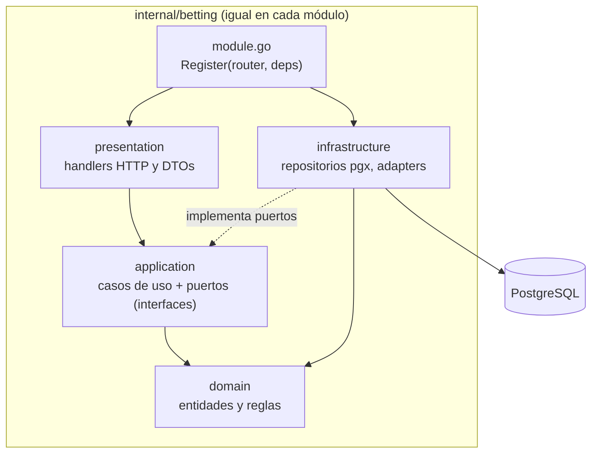
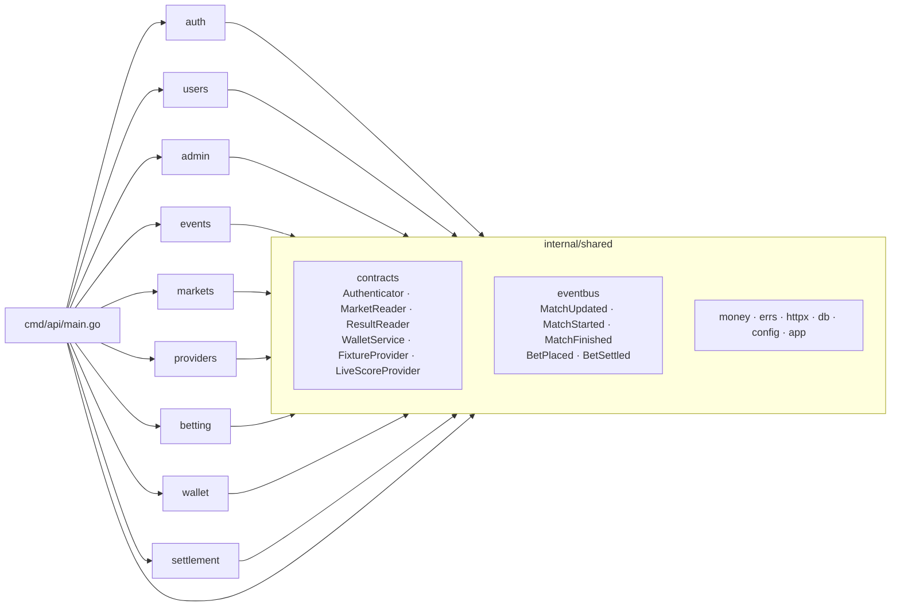

# Persona 1 — Plataforma y Auth

**GitHub:** @Kevrc · **Módulos:** auth, users, admin; features/auth y features/admin

## Diagrama de capas corregido (capas con inversión de dependencias)

### Qué se corrigió de la propuesta original

La propuesta original tenía dos defectos:

- **Flechas hacia la infraestructura.** El diagrama mostraba Dominio → PostgreSQL y Dominio → Adapter, es decir, el dominio dependía de la infraestructura.
- **Capas en la raíz.** Las capas eran carpetas en la raíz (`domain/`, `application/`…).

La versión corregida invierte esas dependencias:

1. **Las interfaces viven adentro.** Dominio y aplicación definen las interfaces (puertos) y la infraestructura las implementa. Todas las flechas apuntan hacia el dominio.
2. **Un directorio por módulo.** Cada módulo tiene las cuatro capas adentro, en lugar de una carpeta por capa en la raíz.
3. **Los módulos no se conocen entre sí.** Solo se comunican por las interfaces de `shared/contracts` y el bus de eventos.

### Dentro de un módulo

Reglas:
- `domain` no importa ninguna otra capa ni librerías de infraestructura (pgx, chi, net/http).
- `application` define los puertos que necesita, por ejemplo `BetRepository`.
- `infrastructure` los implementa con pgx.
- `module.go` es el único punto que conecta todas las capas.

### Entre módulos

- **Solo `main.go` conoce los módulos.** Construye los contratos (real o fake) y los entrega a cada `Register` dentro de `app.Deps`.
- **Un módulo nunca importa otro.** Por ejemplo, `betting` usa `contracts.WalletService` y nunca `internal/wallet`.
- **CI lo hace cumplir.** [`scripts/check-imports.sh`](../scripts/check-imports.sh) falla si un módulo importa a otro, si `shared` importa un módulo o si un `domain` importa infraestructura.

### Patrones

| Patrón | Dónde |
|---|---|
| Capas con inversión de dependencias | Cada módulo (`domain` ← `application` ← `infrastructure` / `presentation`) |
| Repository | Puertos en `application`, implementaciones pgx en `infrastructure` |
| Adapter | `providers`: ReplayProvider y API-Football implementan `FixtureProvider` y `LiveScoreProvider` |
| Publish/Subscribe | `shared/eventbus`, bus en memoria entre módulos |

## Seguridad: JWT corto + refresh revocable, roles, middleware

_Pendiente._

## Atributos de calidad (Acme)

_Pendiente. Se completa cuando el login esté integrado y los requisitos no funcionales tengan números (pendiente del plan: carga, p95 y pasos para apostar)._

## PASA: escenario de prueba de carga

_Pendiente. Depende de fijar los números del punto anterior. Si el sábado hay atraso, el plan permite documentar el escenario sin medirlo._
