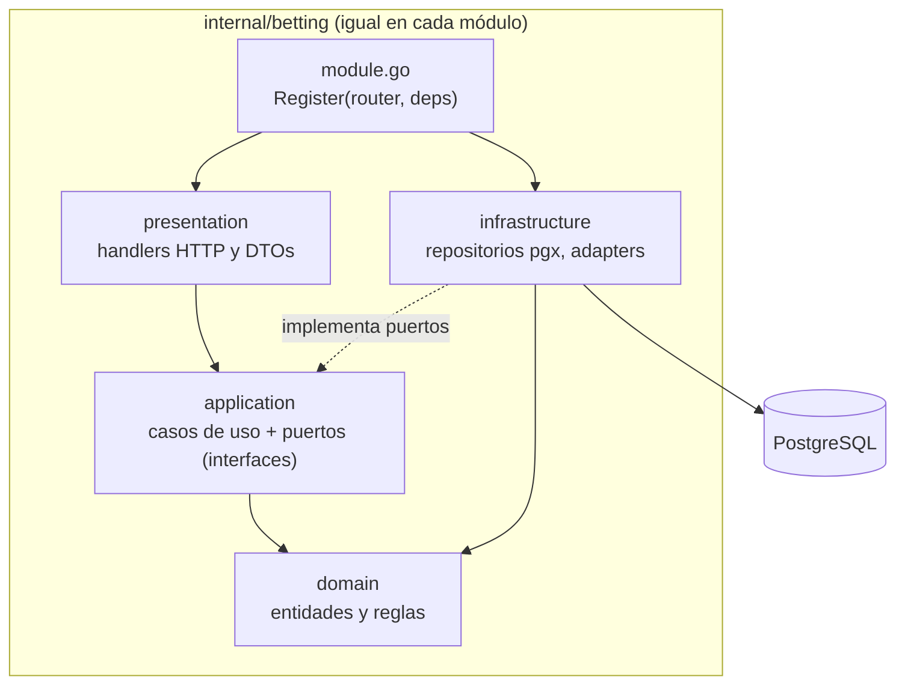
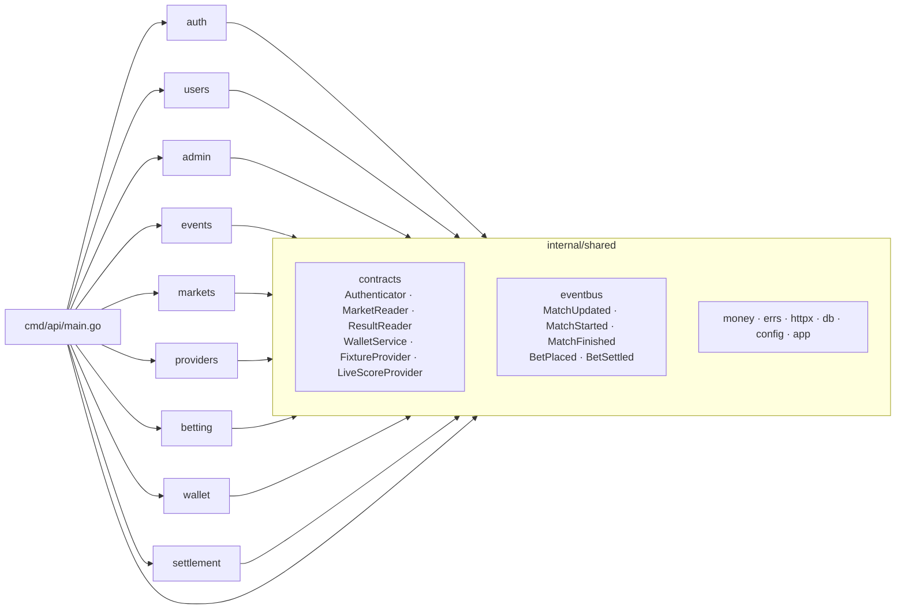
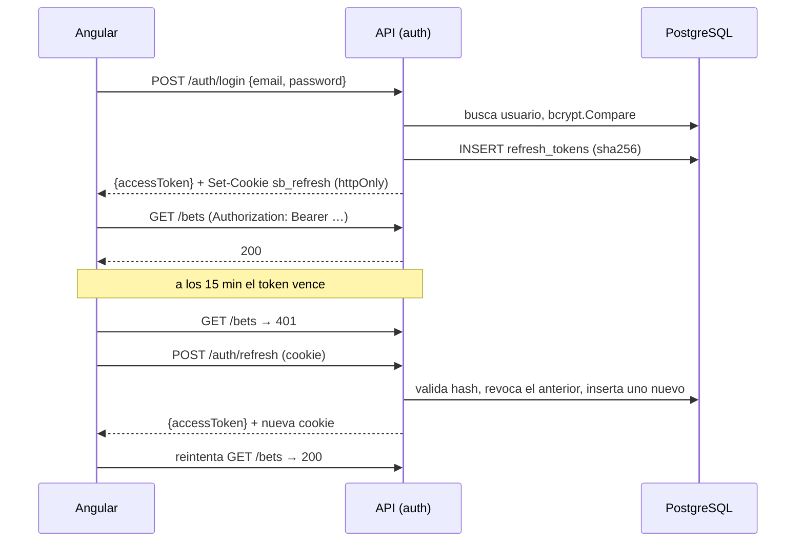

# Persona 1 — Plataforma y Auth

**GitHub:** @Kevrc · **Módulos:** auth, users, admin; features/auth y features/admin

## Diagrama de capas corregido (capas con inversión de dependencias)

### Qué se corrigió de la propuesta original

La propuesta original tenía dos defectos:

- **Flechas hacia la infraestructura.** El diagrama mostraba Dominio → PostgreSQL y Dominio → Adapter, es decir, el dominio dependía de la infraestructura.
- **Capas en la raíz.** Las capas eran carpetas en la raíz (`domain/`, `application/`…).

La versión corregida invierte esas dependencias:

1. **Las interfaces viven adentro.** Dominio y aplicación definen las interfaces (puertos) y la infraestructura las implementa. Todas las flechas apuntan hacia el dominio.
2. **Un directorio por módulo.** Cada módulo tiene las cuatro capas adentro, en lugar de una carpeta por capa en la raíz.
3. **Los módulos no se conocen entre sí.** Solo se comunican por las interfaces de `shared/contracts` y el bus de eventos.

### Dentro de un módulo



Reglas:
- `domain` no importa ninguna otra capa ni librerías de infraestructura (pgx, chi, net/http).
- `application` define los puertos que necesita, por ejemplo `BetRepository`.
- `infrastructure` los implementa con pgx.
- `module.go` es el único punto que conecta todas las capas.

### Entre módulos



- **Solo `main.go` conoce los módulos.** Construye los contratos (real o fake) y los entrega a cada `Register` dentro de `app.Deps`.
- **Un módulo nunca importa otro.** Por ejemplo, `betting` usa `contracts.WalletService` y nunca `internal/wallet`.
- **CI lo hace cumplir.** [`scripts/check-imports.sh`](../scripts/check-imports.sh) falla si un módulo importa a otro, si `shared` importa un módulo o si un `domain` importa infraestructura.

### Patrones

| Patrón | Dónde |
|---|---|
| Capas con inversión de dependencias | Cada módulo (`domain` ← `application` ← `infrastructure` / `presentation`) |
| Repository | Puertos en `application`, implementaciones pgx en `infrastructure` |
| Adapter | `providers`: ReplayProvider y API-Football implementan `FixtureProvider` y `LiveScoreProvider` |
| Publish/Subscribe | `shared/eventbus`, bus en memoria entre módulos |

## Seguridad: JWT corto + refresh revocable, roles, middleware

### Diseño

| Elemento | Decisión |
|---|---|
| Token de acceso | JWT HS256, 15 min (`JWT_ACCESS_TTL`). Su vencimiento, el del refresh y el `Max-Age` de la cookie salen del mismo reloj (`app.Deps.Clock`). Claims: `sub` (ID de usuario), `role`, `iss`, `iat` y `exp`. En el frontend vive solo en memoria, nunca en `localStorage` |
| Refresh token | Valor opaco aleatorio de 32 bytes. En la base de datos se guarda solo su sha256 (`refresh_tokens.token_hash`). Dura 7 días (`JWT_REFRESH_TTL`) y se rota en cada uso |
| Transporte del refresh | Cookie `httpOnly`, `SameSite=Strict`, `Path=/api/v1/auth`, `Secure` en producción. JavaScript no puede leerla |
| Cierre de sesión | `POST /auth/logout` marca `revoked_at`. Un refresh revocado o vencido responde 401 |
| Contraseñas | bcrypt con costo por defecto. Mínimo 8 caracteres (no bytes) y máximo 72 bytes, el límite de bcrypt; más largas responden 400, no 500 |
| Roles | `user` y `admin` (`users.role`). Las rutas `/admin/*` exigen `RequireRole(admin)` |
| Validación | Solo se acepta HS256 (`WithValidMethods`), con verificación de `iss`, para impedir tokens con `alg: none` o con otro algoritmo |
| Secreto | `JWT_SECRET` de al menos 32 caracteres. Fuera de desarrollo, la API no arranca si es más corto |

### Flujo de sesión



En el frontend, `authInterceptor` agrega el `Bearer`. Ante un 401 llama una sola vez a `/auth/refresh`, aunque haya varios requests fallando a la vez, y reintenta. Al recargar la página, `provideAppInitializer` recupera la sesión desde la cookie.

### Estado de implementación

| Pieza | Estado | Archivo |
|---|---|---|
| Middleware `RequireAuth` / `RequireRole` (contrato `Authenticator`) | ✅ Hecho y probado | [`auth/presentation/middleware.go`](../backend/internal/auth/presentation/middleware.go) |
| Emisión y validación de JWT | ✅ Hecho | [`auth/infrastructure/jwt.go`](../backend/internal/auth/infrastructure/jwt.go) |
| Hash de contraseñas | ✅ Hecho | [`auth/domain/password.go`](../backend/internal/auth/domain/password.go) |
| Tablas `users` y `refresh_tokens` | ✅ Hecho | [`migrations/0001_init.sql`](../backend/migrations/0001_init.sql) |
| Interceptor, store de sesión y guards en Angular | ✅ Hecho | [`frontend/src/app/core/auth/`](../frontend/src/app/core/auth/) |
| Pantallas de login y registro (mismas reglas de contraseña que el backend, `returnUrl` solo interno) | ✅ Hecho y probado | [`features/auth/`](../frontend/src/app/features/auth/) |
| Panel de administración: listar usuarios, bloquear o desbloquear, dar o quitar admin | ✅ Hecho y probado | [`features/admin/`](../frontend/src/app/features/admin/) |
| `POST /auth/register`: crea el usuario, su billetera y su refresh token en una sola transacción | ✅ Hecho y probado | [`auth/application/service.go`](../backend/internal/auth/application/service.go) |
| `POST /auth/login`: misma respuesta si el email no existe o la contraseña falla; 403 si la cuenta está bloqueada | ✅ Hecho y probado | [`auth/presentation/handlers.go`](../backend/internal/auth/presentation/handlers.go) |
| `POST /auth/refresh`: rota el token en una sola sentencia SQL; de dos refresh simultáneos con el mismo token solo uno gana | ✅ Hecho y probado | [`auth/infrastructure/refresh_token_repository.go`](../backend/internal/auth/infrastructure/refresh_token_repository.go) |
| `POST /auth/logout`: revoca el token y borra la cookie; es idempotente | ✅ Hecho y probado | [`auth/presentation/handlers.go`](../backend/internal/auth/presentation/handlers.go) |
| `GET /me` | ✅ Hecho y probado | [`users/presentation/handlers.go`](../backend/internal/users/presentation/handlers.go) |
| `GET /admin/users` (paginado) y `PATCH /admin/users/{id}` (rol y estado). Un admin no puede quitarse el rol ni bloquearse (409 `CANNOT_MODIFY_SELF`) | ✅ Hecho y probado | [`users/application/service.go`](../backend/internal/users/application/service.go) |
| Admin inicial al arrancar (`ADMIN_SEED_EMAIL` / `ADMIN_SEED_PASSWORD`), idempotente y sin promover usuarios existentes | ✅ Hecho y probado | [`auth/application/service.go`](../backend/internal/auth/application/service.go) |
| `GET /admin/stats` y `GET /admin/audit`: el módulo admin escucha `BetPlaced` y `BetSettled` en el bus y los guarda en `audit_log`; el panel muestra cifras y actividad reciente | ✅ Hecho y probado | [`admin/`](../backend/internal/admin/) |
| Prueba de carga (k6) y análisis PASA | ✅ Hecho y medido | [`loadtest/`](../loadtest/README.md) |

### Riesgos y mitigaciones

| Amenaza | Mitigación |
|---|---|
| Robo del token por XSS | El token de acceso vive solo en memoria y dura 15 min. El refresh va en una cookie que JavaScript no lee |
| CSRF sobre `/auth/refresh` | Cookie `SameSite=Strict` restringida a `Path=/api/v1/auth`. CORS solo permite `CORS_ALLOWED_ORIGINS` |
| Reutilización de un refresh robado | Rotación en cada uso. El anterior queda revocado y reusarlo responde 401. *Mejora futura:* al detectar un reuso, revocar todas las sesiones del usuario |
| Fuerza bruta en login | bcrypt encarece cada intento. *Mejora futura:* límite de intentos por IP |
| Escalada de privilegios | El rol viaja firmado en el JWT. Las rutas de admin pasan por `RequireRole`. El seed nunca promueve a un usuario existente |
| Usuario bloqueado con sesión abierta | No puede hacer login ni refresh (403). Su token de acceso vigente dura como máximo 15 min más |
| Sistema sin administradores | Un admin no puede quitarse su rol ni bloquearse a sí mismo |
| Fuga de la base de datos | Solo se guardan hashes: bcrypt para contraseñas y sha256 para los refresh tokens |

## Descripción de la arquitectura en Acme

[Acme](https://www.cs.cmu.edu/~acme/) es un lenguaje de descripción de arquitecturas (ADL) del SEI/CMU. Describe el sistema como **componentes** con **puertos**, **conectores** con **roles** y **attachments** que los unen. Las propiedades llevan los atributos que importan para el análisis (latencia, presupuesto, atomicidad).

```acme
Family SportBetFam = {
  Port Type HttpPort, SqlPort, PublishPort, SubscribePort, SsePort;
  Role Type Caller, Callee, Publisher, Subscriber;
  Component Type Module = { Property owner : string; Property layers : string = "domain, application, infrastructure, presentation"; };
  Connector Type RestCall = { Role caller : Caller; Role callee : Callee; };
  Connector Type SqlTx = { Role client : Caller; Role db : Callee; Property atomic : boolean = true; };
  Connector Type EventBus = { Role publisher : Publisher; Role subscriber : Subscriber; Property delivery : string = "en memoria, al menos una vez no garantizado"; };
  Connector Type Sse = { Role server : Publisher; Role client : Subscriber; };
}

System SportBet : SportBetFam = {
  // ---- Componentes ----
  Component Angular = { Port api : HttpPort; Port live : SsePort; Property spa : boolean = true; };

  Component Auth : Module = { Port rest : HttpPort; Port db : SqlPort; Property owner = "Persona 1";
    Property tokens : string = "JWT HS256 15 min + refresh opaco rotado"; };
  Component Users : Module = { Port rest : HttpPort; Port db : SqlPort; Property owner = "Persona 1"; };
  Component Events : Module = { Port rest : HttpPort; Port db : SqlPort; Port pub : PublishPort; Port sse : SsePort;
    Property owner = "Persona 2"; };
  Component Markets : Module = { Port rest : HttpPort; Port db : SqlPort; Port sub : SubscribePort; Property owner = "Persona 2"; };
  Component SyncWorker : Module = { Port provider : HttpPort; Port db : SqlPort; Port pub : PublishPort;
    Property owner = "Persona 2"; Property budget : string = "100 llamadas/día, 10/min"; };
  Component Betting : Module = { Port rest : HttpPort; Port db : SqlPort; Property owner = "Persona 3"; };
  Component Wallet : Module = { Port rest : HttpPort; Port db : SqlPort; Property owner = "Persona 3";
    Property debit : string = "UPDATE ... WHERE balance_cents >= monto"; };
  Component Settlement : Module = { Port db : SqlPort; Port sub : SubscribePort; Property owner = "Persona 3"; };

  Component PostgreSQL = { Port sql : SqlPort; };
  Component APIFootball = { Port rest : HttpPort; Property external : boolean = true; };

  // ---- Conectores ----
  Connector RestApi : RestCall = { Property base : string = "/api/v1"; Property auth : string = "Bearer JWT"; };
  Connector LiveStream : Sse = { Property path : string = "/api/v1/events/stream"; };
  Connector Bus : EventBus = { Property topics : string = "match.updated, match.started, match.finished"; };
  Connector ProviderHttp : RestCall = { Property adapter : string = "FixtureProvider, LiveScoreProvider, StandingsProvider"; };
  Connector Db : SqlTx;
  // Los módulos no se llaman entre sí: usan las interfaces de shared/contracts
  // (MarketReader, ResultReader, WalletService) que main.go inyecta.
  Connector Contracts : RestCall = { Property kind : string = "llamada en proceso por interfaz"; };

  // ---- Attachments ----
  Attachments {
    Angular.api to RestApi.caller;
    Auth.rest to RestApi.callee;  Users.rest to RestApi.callee;  Events.rest to RestApi.callee;
    Markets.rest to RestApi.callee;  Betting.rest to RestApi.callee;  Wallet.rest to RestApi.callee;

    Events.sse to LiveStream.server;  Angular.live to LiveStream.client;

    SyncWorker.provider to ProviderHttp.caller;  APIFootball.rest to ProviderHttp.callee;
    SyncWorker.pub to Bus.publisher;  Events.pub to Bus.publisher;
    Markets.sub to Bus.subscriber;  Settlement.sub to Bus.subscriber;

    Betting.rest to Contracts.caller;  Wallet.rest to Contracts.callee;  // PlaceBet → WalletService.Debit
    Auth.rest to Contracts.caller;                                       // Register → WalletService.CreateWallet

    Auth.db to Db.client;  Users.db to Db.client;  Events.db to Db.client;  Markets.db to Db.client;
    SyncWorker.db to Db.client;  Betting.db to Db.client;  Wallet.db to Db.client;  Settlement.db to Db.client;
    PostgreSQL.sql to Db.db;
  }
}
```

**Restricciones de estilo** (lo que el sistema garantiza y CI verifica):

| Restricción | Cómo se cumple |
|---|---|
| Un módulo no importa otro módulo | `scripts/check-imports.sh` falla el CI si `internal/X` importa `internal/Y` |
| `domain` no depende de infraestructura | El mismo script prohíbe pgx, chi y net/http en `*/domain` |
| Solo `SyncWorker` usa `ProviderHttp` | Es el único que recibe los proveedores; los usuarios leen de la base |
| Débito y apuesta en una sola transacción | `WalletService` recibe el `db.Querier` del llamador (`SqlTx.atomic = true`) |

## PASA: análisis de rendimiento

PASA (*Performance Assessment of Software Architectures*, Williams y Smith) evalúa si una arquitectura cumple sus objetivos de rendimiento siguiendo estos pasos.

### 1. Escenarios críticos y objetivos

Son los requisitos no funcionales que el plan dejó pendientes ("carga, p95 y pasos para apostar"). Propuesta medible:

| Escenario | Por qué es crítico | Objetivo |
|---|---|---|
| **E1 – Navegar** (lista de eventos + detalle) | Es lo que más hace un usuario | p95 < 300 ms con 50 usuarios simultáneos |
| **E2 – Apostar** (`POST /bets`) | Transacción con débito atómico, idempotencia y validación de cuota | p95 < 500 ms con 50 usuarios simultáneos |
| **E3 – Doble gasto** | Riesgo del plan: dos apuestas a la vez con saldo para una | Exactamente una aceptada; saldo nunca negativo |
| **E4 – Marcador en vivo** | Depende de un proveedor externo con 100 llamadas al día | Dato con menos de 5 min; cero llamadas sin partidos destacados en juego |
| Pasos para apostar | Usabilidad | 3: elegir partido → elegir cuota → confirmar monto |

### 2. Decisiones de arquitectura que sostienen los objetivos

- **Los usuarios nunca esperan al proveedor externo.** Solo el Sync Worker consulta API-Football. Los requests leen de PostgreSQL y el SSE empuja los cambios. Por eso E1 no depende de la latencia ni del límite del proveedor.
- **Débito atómico en una sentencia** (`UPDATE … WHERE balance_cents >= monto`), dentro de la misma transacción que la apuesta. Evita el antipatrón "leer saldo y después debitar", que provoca doble gasto, sin bloqueos explícitos (E3).
- **Cuotas calculadas en el servidor y congeladas al apostar.** Apostar no hace llamadas externas (E2).
- **Presupuesto del proveedor como recurso compartido**, con un contador persistido. Hay una consulta en vivo por ciclo para todos los partidos, resultados agrupados por fecha y tablas de posiciones cada 12 h (E4).

### 3. Medición

k6 contra la API real con PostgreSQL 17, en una máquina (Apple M5, 10 núcleos, 24 GB), API y base en el mismo equipo. Los scripts y cómo correrlos están en [`loadtest/`](../loadtest/README.md).

| Escenario | Carga | p95 | p99 | Errores | Resultado |
|---|---|---|---|---|---|
| E1 – Navegar y consultar | 50 usuarios, 1 min | **2.6 ms** | 5.9 ms | 0 % | ✅ (objetivo 300 ms) |
| E2 – Apostar | 50 usuarios, 1 min | **8.0 ms** | 15.2 ms | 0 % | ✅ (objetivo 500 ms) |
| Total | 50 usuarios, 1 min | — | — | 0 de 5 801 | 88 req/s |
| E1 con 4× carga | 200 usuarios, 30 s | 2.7 ms | 25.5 ms | 0 % | ✅ |
| E2 con 4× carga | 200 usuarios, 30 s | 14.9 ms | 35.4 ms | 0 % | ✅, 232 req/s en total |
| E3 – Doble gasto | 20 apuestas simultáneas, saldo para 1 | — | — | — | ✅ 1 aceptada, 19 `INSUFFICIENT_FUNDS`, saldo final 1.00 |

E4 se verificó con la API real: una consulta en vivo trae todos los partidos en juego, y el día de pruebas se usaron 58 de las 100 llamadas, contando varios reinicios de la API y llamadas manuales de verificación.

### 4. Análisis

- **Hay margen de sobra en E1 y E2.** Con 4 veces la carga objetivo, el p95 sigue dos órdenes de magnitud por debajo del objetivo. El cuello de botella esperado es PostgreSQL (conexiones del pool y bloqueos de fila en `wallets`), no la API.
- **El p99 sube con 200 usuarios** (25–35 ms). Es la cola de espera del pool de conexiones; sigue muy por debajo de los objetivos.
- **Limitaciones de la medición:**
  - API y base comparten máquina, sin latencia de red real.
  - La base es pequeña: 3 partidos y unos 250 usuarios.
  - El registro (bcrypt) no está en el escenario, porque se hace una vez por usuario.
  - En producción conviene repetir la prueba con la base en otro host.

### 5. Alternativas si la carga creciera

| Riesgo | Alternativa |
|---|---|
| Lecturas de eventos muy frecuentes | Caché en memoria de `GET /events` invalidada por `match.updated` del bus |
| Pool de conexiones saturado | Ajustar `pgxpool` (`max_conns`) o poner PgBouncer delante |
| Bus en memoria con varias instancias de la API | Reemplazar `eventbus.InMemory` por Postgres `LISTEN/NOTIFY` o Redis; el contrato `eventbus.Bus` no cambia |
| Presupuesto del proveedor | Plan pago de API-Football, o un segundo proveedor (football-data.org) detrás de la misma interfaz |
