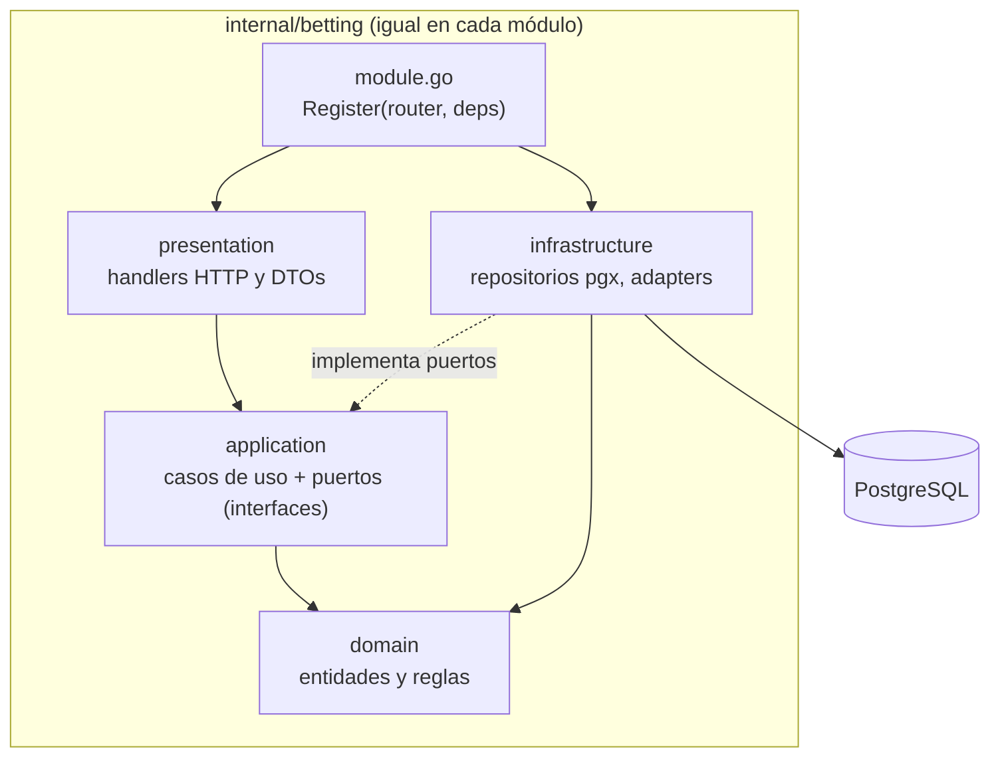
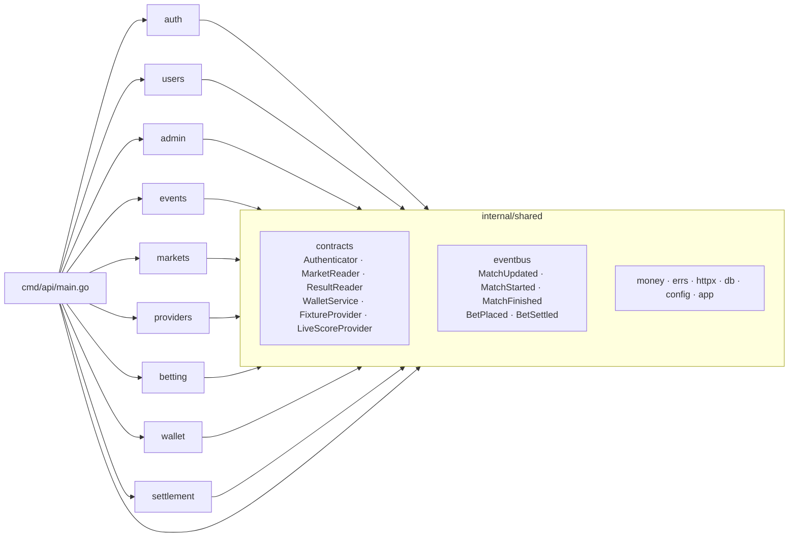
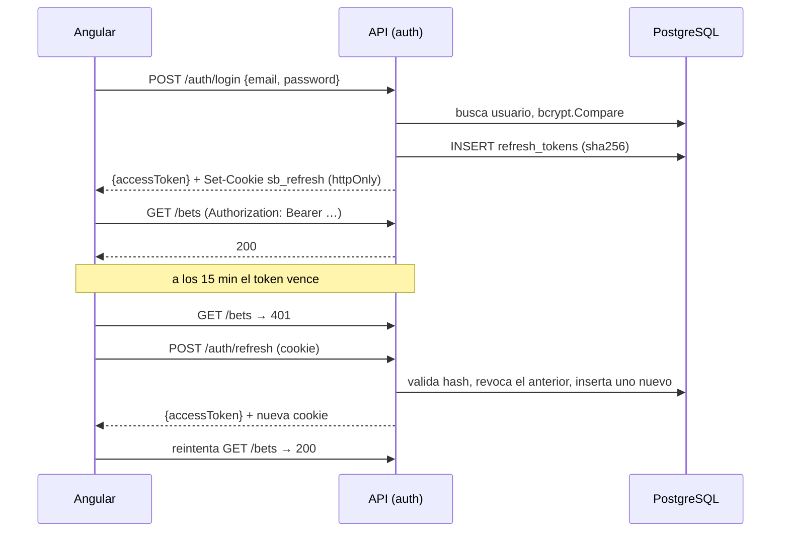

# Persona 1 — Plataforma y Auth

**GitHub:** @Kevrc · **Módulos:** auth, users, admin; features/auth y features/admin

## Diagrama de capas corregido (capas con inversión de dependencias)

### Qué se corrigió de la propuesta original

La propuesta original tenía dos defectos:

- **Flechas hacia la infraestructura.** El diagrama mostraba Dominio → PostgreSQL y Dominio → Adapter, es decir, el dominio dependía de la infraestructura.
- **Capas en la raíz.** Las capas eran carpetas en la raíz (`domain/`, `application/`…).

La versión corregida invierte esas dependencias:

1. **Las interfaces viven adentro.** Dominio y aplicación definen las interfaces (puertos) y la infraestructura las implementa. Todas las flechas apuntan hacia el dominio.
2. **Un directorio por módulo.** Cada módulo tiene las cuatro capas adentro, en lugar de una carpeta por capa en la raíz.
3. **Los módulos no se conocen entre sí.** Solo se comunican por las interfaces de `shared/contracts` y el bus de eventos.

### Dentro de un módulo

Reglas:
- `domain` no importa ninguna otra capa ni librerías de infraestructura (pgx, chi, net/http).
- `application` define los puertos que necesita, por ejemplo `BetRepository`.
- `infrastructure` los implementa con pgx.
- `module.go` es el único punto que conecta todas las capas.

### Entre módulos

- **Solo `main.go` conoce los módulos.** Construye los contratos (real o fake) y los entrega a cada `Register` dentro de `app.Deps`.
- **Un módulo nunca importa otro.** Por ejemplo, `betting` usa `contracts.WalletService` y nunca `internal/wallet`.
- **CI lo hace cumplir.** [`scripts/check-imports.sh`](../scripts/check-imports.sh) falla si un módulo importa a otro, si `shared` importa un módulo o si un `domain` importa infraestructura.

### Patrones

| Patrón | Dónde |
|---|---|
| Capas con inversión de dependencias | Cada módulo (`domain` ← `application` ← `infrastructure` / `presentation`) |
| Repository | Puertos en `application`, implementaciones pgx en `infrastructure` |
| Adapter | `providers`: ReplayProvider y API-Football implementan `FixtureProvider` y `LiveScoreProvider` |
| Publish/Subscribe | `shared/eventbus`, bus en memoria entre módulos |

## Seguridad: JWT corto + refresh revocable, roles, middleware

### Diseño

| Elemento | Decisión |
|---|---|
| Token de acceso | JWT HS256, 15 min (`JWT_ACCESS_TTL`). Claims: `sub` (ID de usuario), `role`, `iss`, `iat` y `exp`. En el frontend vive solo en memoria, nunca en `localStorage` |
| Refresh token | Valor opaco aleatorio de 32 bytes. En la base de datos se guarda solo su sha256 (`refresh_tokens.token_hash`). Dura 7 días (`JWT_REFRESH_TTL`) y se rota en cada uso |
| Transporte del refresh | Cookie `httpOnly`, `SameSite=Strict`, `Path=/api/v1/auth`, `Secure` en producción. JavaScript no puede leerla |
| Cierre de sesión | `POST /auth/logout` marca `revoked_at`. Un refresh revocado o vencido responde 401 |
| Contraseñas | bcrypt con costo por defecto, mínimo 8 caracteres |
| Roles | `user` y `admin` (`users.role`). Las rutas `/admin/*` exigen `RequireRole(admin)` |
| Validación | Solo se acepta HS256 (`WithValidMethods`), con verificación de `iss`, para impedir tokens con `alg: none` o con otro algoritmo |
| Secreto | `JWT_SECRET` de al menos 32 caracteres. Fuera de desarrollo, la API no arranca si es más corto |

### Flujo de sesión

En el frontend, `authInterceptor` agrega el `Bearer`. Ante un 401 llama una sola vez a `/auth/refresh`, aunque haya varios requests fallando a la vez, y reintenta. Al recargar la página, `provideAppInitializer` recupera la sesión desde la cookie.

### Estado de implementación

| Pieza | Estado | Archivo |
|---|---|---|
| Middleware `RequireAuth` / `RequireRole` (contrato `Authenticator`) | ✅ Hecho y probado | [`auth/presentation/middleware.go`](../backend/internal/auth/presentation/middleware.go) |
| Emisión y validación de JWT | ✅ Hecho | [`auth/infrastructure/jwt.go`](../backend/internal/auth/infrastructure/jwt.go) |
| Hash de contraseñas | ✅ Hecho | [`auth/domain/password.go`](../backend/internal/auth/domain/password.go) |
| Tablas `users` y `refresh_tokens` | ✅ Hecho | [`migrations/0001_init.sql`](../backend/migrations/0001_init.sql) |
| Interceptor, store de sesión y guards en Angular | ✅ Hecho | [`frontend/src/app/core/auth/`](../frontend/src/app/core/auth/) |
| `POST /auth/register`: crea el usuario y su billetera en una sola transacción | ⏳ Pendiente | — |
| `POST /auth/login`, `/auth/refresh` (con rotación) y `/auth/logout` | ⏳ Pendiente | — |
| `GET /me` y `/admin/users` | ⏳ Pendiente | — |
| Seed del admin (`ADMIN_SEED_EMAIL` / `ADMIN_SEED_PASSWORD`) | ⏳ Pendiente | — |

### Riesgos y mitigaciones

| Amenaza | Mitigación |
|---|---|
| Robo del token por XSS | El token de acceso vive solo en memoria y dura 15 min. El refresh va en una cookie que JavaScript no lee |
| CSRF sobre `/auth/refresh` | Cookie `SameSite=Strict` restringida a `Path=/api/v1/auth`. CORS solo permite `CORS_ALLOWED_ORIGINS` |
| Reutilización de un refresh robado | Rotación en cada uso. El anterior queda revocado |
| Fuerza bruta en login | bcrypt encarece cada intento. *Mejora futura:* límite de intentos por IP |
| Escalada de privilegios | El rol viaja firmado en el JWT. Las rutas de admin pasan por `RequireRole` |
| Fuga de la base de datos | Solo se guardan hashes: bcrypt para contraseñas y sha256 para los refresh tokens |

## Atributos de calidad (Acme)

_Pendiente. Se completa cuando el login esté integrado y los requisitos no funcionales tengan números (pendiente del plan: carga, p95 y pasos para apostar)._

## PASA: escenario de prueba de carga

_Pendiente. Depende de fijar los números del punto anterior. Si el sábado hay atraso, el plan permite documentar el escenario sin medirlo._
