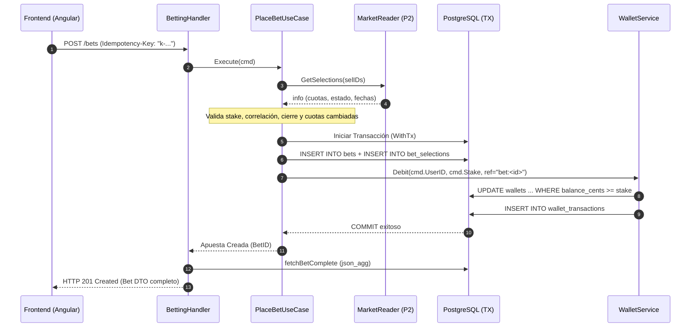

# Persona 3 — Núcleo Transaccional (Betting, Wallet, Settlement)

**Autor / GitHub:** @By-Alvarez06  
**Módulos asignados:** `internal/betting/`, `internal/wallet/`, `internal/settlement/`  
**Entrega:** 13 oct 2026 · **Stack:** Go 1.26, PostgreSQL 17, chi v5, pgx v5, Docker  

---

## 1. Resumen Ejecutivo del Rol y Responsabilidades

Como **Persona 3 (Núcleo Transaccional)**, la responsabilidad en SportBet es el centro financiero y operativo del sistema:
1. **Billetera y Ledger (`wallet`):** Custodiar los saldos de los usuarios, garantizando cero sobregiros (sin saldo negativo accidental), concurrencia segura mediante operaciones atómicas y trazabilidad inmutable de cada centavo.
2. **Motor de Apuestas (`betting`):** Aceptar y validar apuestas simples (1 selección) y combinadas (2 a 5 selecciones), verificar mercados y cuotas en tiempo real, debitar fondos atómicamente y blindar el sistema contra reintentos de red o doble clic mediante claves de idempotencia.
3. **Motor de Liquidación (`settlement`):** Determinar de forma automática e idempotente si las apuestas resultan ganadas (`WON`), perdidas (`LOST`) o anuladas (`VOID`), calculando los pagos correspondientes y acreditándolos en las billeteras, ya sea al recibir eventos del partido o mediante un barrido de recuperación en segundo plano.

---

## 2. Mapa del Código Realizado

Toda la implementación respeta la **arquitectura en capas con inversión de dependencias** exigida por el proyecto. A continuación se detalla cada archivo desarrollado:

```
backend/internal/
├── wallet/                               # Módulo de Billetera y Movimientos
│   ├── infrastructure/
│   │   ├── service.go                   # Implementación de contracts.WalletService (CreateWallet, Debit, Credit, Balance)
│   │   └── service_test.go              # Pruebas de integración con esquema aislado (testPool)
│   ├── presentation/
│   │   └── handler.go                   # HTTP Handlers: GET /wallet y GET /wallet/transactions
│   └── module.go                        # Registro de rutas chi e inyección de dependencias
│
├── betting/                              # Módulo de Colocación e Historial de Apuestas
│   ├── domain/
│   │   ├── bet.go                       # Entidades Bet, BetSelection y estados (PENDING, WON, LOST, VOID)
│   │   └── errors.go                    # Errores de dominio (cuota cambiada, correlación, montos fuera de rango)
│   ├── application/
│   │   ├── place_bet.go                 # Caso de uso PlaceBetUseCase (validaciones, cálculo de cuotas y Tx atómica)
│   │   └── place_bet_test.go            # Pruebas unitarias y de integración de apuestas
│   ├── infrastructure/
│   │   └── repository.go                # Inserción en PostgreSQL de bets y bet_selections
│   ├── presentation/
│   │   ├── handler.go                   # HTTP Handlers: POST /bets y GET /bets (paginado)
│   │   └── fetch.go                     # Reconstrucción de apuestas con subconsultas json_agg completas
│   └── module.go                        # Registro de endpoints y dependencias
│
└── settlement/                           # Módulo de Liquidación y Pagos
    ├── application/
    │   ├── settler.go                   # Orquestador Settler: SettleEvent, SettleBet y Sweep
    │   └── settler_test.go              # Pruebas de combinadas, reglas WIN/LOST/VOID y pagos
    ├── infrastructure/
    │   └── repository.go                # Consultas y updates SQL atómicos con optimismo
    ├── presentation/
    │   └── handler.go                   # HTTP Handler administrativo: POST /admin/settlement/run
    └── module.go                        # Suscripción al EventBus (MatchFinished) y cron worker de fondo
```

---

## 3. Arquitectura y Funcionamiento Interno Detallado

### 3.1. Módulo `wallet`: El Ledger Inmutable y Débito Atómico

#### A. Invariante Contable y Representación de Dinero
- **Sin punto flotante:** Todo el dinero se maneja como `money.Money` en centavos enteros (`int64`), donde `$10.00` = `1000`. Esto elimina por completo los errores de redondeo de punto flotante de IEEE-754.
- **Ledger Inmutable:** Cada cambio de saldo genera un registro obligatorio en `wallet_transactions`. Invariante del sistema:
  $$\text{wallets.balance\_cents} = \sum \text{wallet\_transactions.amount\_cents}$$
- **Signos contables:** 
  - Cantidades positivas ($> 0$): `DEPOSIT_INITIAL`, `BET_PAYOUT`, `BET_REFUND`.
  - Cantidades negativas ($< 0$): `BET_STAKE`, `BET_PAYOUT_REVERSAL`, `BET_REFUND_REVERSAL`.

#### B. El Débito Atómico sin Bloqueos Pesados (Prevención de Overdraft)
Para evitar que dos peticiones simultáneas lean un saldo de `$10.00`, ambas aprueben una apuesta de `$10.00` y dejen la cuenta en `-$10.00` (*race condition*), implementamos una sentencia **Common Table Expression (CTE)** atómica:

```sql
WITH updated AS (
    UPDATE wallets
    SET balance_cents = balance_cents - $1, updated_at = now()
    WHERE user_id = $2 AND balance_cents >= $1
    RETURNING balance_cents
)
INSERT INTO wallet_transactions (user_id, type, amount_cents, balance_after_cents, reference)
SELECT $2, $3, -$1, balance_cents, $4
FROM updated
RETURNING balance_after_cents;
```

**Por qué es una solución de alto nivel:**
1. Si el saldo es menor que `$1`, la cláusula `WHERE balance_cents >= $1` no empareja ninguna fila.
2. `updated` queda vacío, por lo que el `INSERT` no inserta nada.
3. PostgreSQL retorna `pgx.ErrNoRows`, que el servicio traduce a un error `errs.ErrInsufficientFunds` (código HTTP `422` con `INSUFFICIENT_FUNDS`).
4. Todo ocurre en una única sentencia atómica en el motor de base de datos a nivel de fila, sin necesidad de locks distribuidos en Go ni lecturas previas (`SELECT FOR UPDATE`).

#### C. Creación de Billetera "On-The-Fly"
Para garantizar compatibilidad con usuarios que se crearon antes de desplegar las migraciones o el usuario administrador de prueba (`admin@sportbet.local`), el método `Balance()` consulta la base de datos: si el usuario no tiene billetera (`pgx.ErrNoRows`), invoca `CreateWallet` automáticamente con saldo inicial `0`, devolviendo un saldo válido en lugar de un error HTTP 500.

---

### 3.2. Módulo `betting`: Motor de Apuestas e Idempotencia

#### A. Reglas de Dominio y Negocio
- **Montos permitidos:** Stake mínimo de `100` centavos ($1.00) y máximo de `50000` centavos ($500.00).
- **Límites de Pago y Cuotas:** Cuota total máxima de `500.00` (`50000`) y pago potencial máximo de `10 000.00` (`1000000` centavos).
- **Límite de Selecciones:** Mínimo 1 (simple) y máximo 5 (combinada).
- **Prohibición de Apuestas Correlacionadas:** Está estrictamente prohibido combinar dos selecciones del mismo partido (ej. victoria local + Más de 2.5 goles del mismo encuentro). Se valida mediante `eventSet[info.EventID]` respondiendo `422` con código `CORRELATED_SELECTIONS`.
- **Cierre de Mercados por Reloj:** Se consulta el contrato `MarketReader` de la Persona 2. El método `info.IsOpen(now)` exige que el partido esté en estado `SCHEDULED`, el mercado `OPEN` y que resten más de 60 segundos antes del inicio programado (`start_at - 60s`).

#### B. Detección de Cuota Cambiada (HTTP 409 `ODDS_CHANGED`)
El frontend envía la cuota que el usuario vio en pantalla (`oddX100`). Si la cuota en el backend difiere de la recibida:
- La apuesta **no** se procesa.
- Se responde HTTP 409 con el error estructurado `ODDS_CHANGED`.
- El frontend refresca automáticamente las cuotas vigentes para que el usuario confirme si acepta la nueva cuota.

#### C. Transacción Atómica de Colocación (`PlaceBetUseCase`)
La creación de la apuesta y el cobro del saldo se ejecutan dentro de la misma transacción de PostgreSQL (`db.WithTx`):



Si el débito falla por saldo insuficiente, o la inserción falla por cualquier restricción, la transacción hace **ROLLBACK completo**: no se descuenta ni un centavo y no queda rastro de la apuesta.

#### D. Idempotencia Robusta (Garantía ante Reintentos de Red y Doble Clic)
1. El cliente envía la cabecera `Idempotency-Key`.
2. La tabla `bets` tiene una restricción única: `CONSTRAINT bets_user_idempotency_key UNIQUE (user_id, idempotency_key)`.
3. Si el usuario presiona dos veces el botón, o la conexión se interrumpe y el navegador reintenta con la misma clave:
   - La base de datos arroja una violación de clave única (`bets_user_idempotency_key`).
   - El repositorio detecta la violación y devuelve `errs.ErrAlreadyProcessed`.
   - El handler **no falla con 500 ni cobra dos veces**: recupera la apuesta original creada previamente (`fetchBetByIdempotencyKey`) y responde con **HTTP 200 OK** y la apuesta intacta.

---

### 3.3. Módulo `settlement`: Liquidación y Pagos

El liquidador (`Settler`) es el orquestador que evalúa los resultados de los partidos y emite los premios económicos.

#### A. Activación Dual (Reactiva y Proactiva)
1. **Canal Reactivo (EventBus):** Se suscribe a `eventbus.MatchFinished` publicado por la Persona 2 cuando un partido termina.
2. **Canal Proactivo (Barrido / Sweep Worker):** Dado que el bus de eventos en memoria puede perder mensajes si el servidor se reinicia justo al terminar un encuentro, se ejecuta un worker en segundo plano cada 5 minutos (`SweepInterval = 5 * time.Minute`) usando `d.Lifecycle.Go`:
   - Consulta `ResultReader.ListFinishedSince` (partidos finalizados en las últimas 48 horas).
   - Liquida cualquier apuesta que haya quedado rezagada en estado `PENDING`.
3. **Endpoint Administrativo:** Se dispone de `POST /admin/settlement/run` (requiere rol de `admin`) para forzar un barrido inmediato a demanda.

#### B. Separación de Responsabilidades en el Resultado
El módulo `settlement` **no decide** quién ganó el partido. Esa es responsabilidad del módulo `markets` (Persona 2). `Settler` le pide al contrato `ResultReader`:
```go
outcomes, err := s.results.ResolveSelections(ctx, eventID)
```
Esto devuelve un mapa `{ "sel-uuid": WON | LOST | VOID }`. Si un partido fue cancelado o postergado (`POSTPONED`, `CANCELLED`, `ABANDONED`), `markets` marca todas sus selecciones como `VOID`.

#### C. Algoritmo de Resolución de Apuestas
Para cada apuesta pendiente vinculada al evento:
1. **Detección de Derrota:** Si **al menos una** selección es `LOST`, la apuesta completa pasa inmediatamente a **`LOST`** (incluso si tiene otros partidos que no han terminado).
2. **Espera de Resultados:** Si ninguna es `LOST` pero **al menos una** selección sigue en `PENDING`, la apuesta continúa en **`PENDING`** (se esperará al siguiente partido).
3. **Reembolso Total (`VOID`):** Si **todas** las selecciones resultaron `VOID`, la apuesta pasa a `VOID` y se reembolsa el 100% del stake (`BET_REFUND`).
4. **Victoria (`WON`):** Si todas las selecciones terminaron y ninguna es `LOST`:
   - Las selecciones `VOID` se cuentan con cuota neutra `1.00`.
   - Se multiplican las cuotas restantes con `money.Combine`.
   - Se calcula el premio: `payout = bet.Stake.MulOdds(totalOdd)` (tope de `$10,000.00`).
   - Se acredita en la billetera del usuario mediante `wallet.Credit` con referencia única `bet:<id>:v<version>` y tipo `BET_PAYOUT`.

#### D. Idempotencia y Optimismo en la Liquidación
Para evitar pagar un premio dos veces ante ejecuciones simultáneas del sweep o del bus:
```sql
UPDATE bets
SET status = $1, payout_cents = $2, settled_at = now()
WHERE id = $3 AND status = 'PENDING';
```
Si otra transacción ya cambió el estado a `WON`, esta sentencia afecta `0` filas (`res.RowsAffected() == 0`). Al detectar 0 filas, `settlement` cancela la ejecución sin emitir créditos adicionales. Además, `wallet_transactions` tiene `UNIQUE(reference, type)`, impidiendo técnicamente cualquier duplicidad de pagos.

---

## 4. Escenarios de Calidad de Arquitectura (ATAM)

En el marco metodológico ATAM (*Architecture Tradeoff Analysis Method*), a la Persona 3 le corresponden formalmente los escenarios **3** y **5**:

### Escenario ATAM 3: Concurrencia Masiva en Apuestas y Prevención de Sobregiro (Overdraft)
- **Atributo de Calidad:** Consistencia de Datos / Integridad Transaccional / Rendimiento.
- **Estímulo:** Cientos de usuarios intentan colocar apuestas en el último minuto antes del cierre de un partido estelar; usuarios con saldo justo realizan múltiples clics simultáneos o sufren fluctuaciones de red.
- **Entorno:** Sistema bajo carga en horarios punta con alta concurrencia.
- **Artefacto:** Módulos `betting` y `wallet`, tabla `wallets`, tabla `wallet_transactions`.
- **Respuesta de la Arquitectura:**
  1. El débito se realiza mediante la sentencia atómica `UPDATE wallets SET balance_cents = balance_cents - $1 WHERE balance_cents >= $1`.
  2. Ningún usuario puede quedar con saldo negativo bajo ninguna circunstancia de concurrencia normal.
  3. Los reintentos accidentales con la misma `Idempotency-Key` devuelven la apuesta original con HTTP 200 sin volver a debitar.
  4. Los casos sin fondos devuelven limpiamente HTTP 422 `INSUFFICIENT_FUNDS` en menos de 50 ms.
- **Medida de Respuesta:** 0 cuentas en sobregiro, 0 transacciones duplicadas, tasa de error por contención nula.

### Escenario ATAM 5: Resiliencia y Consistencia Eventual en la Liquidación
- **Atributo de Calidad:** Disponibilidad / Tolerancia a Fallos / Consistencia Eventual.
- **Estímulo:** Un partido de alta afluencia finaliza y se emite el evento `MatchFinished`, pero el proceso de la API sufre un reinicio no programado durante la liquidación, o la cola en memoria descarta el evento por saturación.
- **Entorno:** Falla temporal de infraestructura o pérdida de eventos en el bus.
- **Artefacto:** Módulo `settlement`, `SweepWorker`, base de datos PostgreSQL.
- **Respuesta de la Arquitectura:**
  1. El worker de barrido periódico (`SweepWorker`) despierta cada 5 minutos e inspecciona todos los partidos culminados en las últimas 48 horas.
  2. Identifica cualquier apuesta pendiente huérfana y la procesa.
  3. Gracias al condicional `WHERE id = $1 AND status = 'PENDING'` y la clave única en el ledger `UNIQUE(reference, type)`, el proceso puede ejecutarse repetidas veces sin riesgo de doble pago.
- **Medida de Respuesta:** El 100% de las apuestas pendientes quedan liquidadas en menos de un ciclo de barrido (máximo 5 minutos tras el restablecimiento del servicio).

---

## 5. Integración y Comunicación con el Frontend (Persona 4)

El Frontend en Angular 22 consume directamente los servicios de la Persona 3 mediante el contrato OpenAPI (`openapi.yaml`). A continuación se describe la relación entre las pantallas de la interfaz y tus endpoints:

### 5.1. El Boleto de Apuestas (`BetSlipComponent` / `BetSlipStore`)
- **Ruta Backend consumida:** `POST /bets` (con cabecera obligatoria `Idempotency-Key`).
- **Comportamiento en Frontend:**
  1. El usuario hace clic en cuotas de partidos; el boleto calcula reactivamente con Angular Signals la cuota combinada (`combineOdds`) y el pago potencial.
  2. Valida en el cliente que no existan selecciones del mismo partido antes de enviar (`PickResult: same-event`).
  3. Al presionar "Apostar", envía el payload:
     ```json
     {
       "stakeCents": 1000,
       "selections": [
         { "selectionId": "099a5c89-...", "oddX100": 214 },
         { "selectionId": "1b34e567-...", "oddX100": 185 }
       ]
     }
     ```
  4. **Manejo de Respuestas:**
     - **201 Created:** Muestra el comprobante con ID, cuota final y pago potencial. Refresca automáticamente el saldo en la barra superior (`walletStore.refresh()`).
     - **200 OK (Idempotente):** Acepta la apuesta sin duplicar cobro ni alertar error.
     - **409 Conflict (`ODDS_CHANGED`):** El boleto muestra una advertencia en amarillo: *"Las cuotas cambiaron. Revisa las nuevas cuotas y confirma para apostar"*, y actualiza los números con las nuevas cuotas para confirmación del usuario.
     - **422 Unprocessable Entity (`INSUFFICIENT_FUNDS`):** Muestra el mensaje: *"Saldo insuficiente para esta apuesta"*.

### 5.2. Historial de Apuestas (`BetHistoryPage`)
- **Ruta Backend consumida:** `GET /bets?page=1&pageSize=10&status=PENDING`
- **Técnica de Alto Rendimiento Implementada:** En lugar de hacer múltiples peticiones N+1 o consultas anidadas en Go, construimos una subconsulta con `json_agg` directamente en PostgreSQL:
  ```sql
  SELECT b.id, b.stake_cents, b.total_odd_x100, b.potential_payout_cents, b.status, b.payout_cents, b.placed_at,
         COALESCE((
             SELECT json_agg(json_build_object(
                 'selectionId', bs.selection_id,
                 'eventId', bs.event_id,
                 'eventName', ht.name || ' vs ' || at.name,
                 'marketCode', m.code,
                 'selectionCode', s.code,
                 'label', s.label,
                 'oddX100', bs.odd_x100,
                 'result', bs.result
             ))
             FROM bet_selections bs
             JOIN selections s ON bs.selection_id = s.id
             JOIN markets m ON s.market_id = m.id
             JOIN events e ON bs.event_id = e.id
             JOIN teams ht ON e.home_team_id = ht.id
             JOIN teams at ON e.away_team_id = at.id
             WHERE bs.bet_id = b.id
         ), '[]'::json) AS selections
  FROM bets b WHERE b.user_id = $1 ...
  ```
- **Resultado en UI:** La pantalla de Angular muestra una tarjeta por apuesta, con insignias de estado (Pendiente en gris, Ganada en verde, Perdida en rojo, Anulada en azul) y el desglose de cada partido con el nombre de los equipos, el mercado elegido y el estado particular de esa selección.

### 5.3. Billetera y Movimientos (`WalletPage` / `WalletStore`)
- **Rutas Backend consumidas:** 
  - `GET /wallet` $\rightarrow$ `{ "balanceCents": 100000, "currency": "VIRT" }`
  - `GET /wallet/transactions?page=1&pageSize=20` $\rightarrow$ Lista paginada con fecha, tipo (`BET_STAKE`, `BET_PAYOUT`, etc.), monto y saldo resultante.
- **Resultado en UI:** Muestra el saldo en formato decimal legible (`1,000.00 VIRT`). En caso de no existir movimientos, la API devuelve `items: []` garantizando que Angular no falle esperando un arreglo.

---

## 6. Pruebas Automatizadas y Estrategia CI

Para cumplir las reglas estrictas de CI de GitHub Actions (`go test -race -count=1 ./...` y `check-imports.sh`), se implementó una estrategia avanzada de aislamiento de pruebas:

### El Patrón `testPool` en Pruebas de Integración
Las pruebas que dependen de base de datos (`place_bet_test.go` y `service_test.go`) no dependen de una base de datos local estática, sino que utilizan el helper `testPool(t *testing.T)`:
1. Lee dinámicamente `TEST_DATABASE_URL` (configurada en el pipeline de GitHub Actions).
2. Genera un esquema único en PostgreSQL por cada prueba ejecutada:
   ```go
   schema := fmt.Sprintf("test_betting_%d", time.Now().UnixNano())
   admin.Exec(ctx, "CREATE SCHEMA "+schema)
   ```
3. Configura el `search_path` de la conexión hacia ese esquema y ejecuta las migraciones de Goose (`db.Migrate`).
4. Al terminar el test, `t.Cleanup` destruye automáticamente el esquema con `DROP SCHEMA ... CASCADE`.
5. **Resultado:** Pruebas 100% concurrentes, sin condiciones de carrera entre pruebas paralelas, sin datos residuales y pasando completamente en verde en GitHub Actions con `-race`.

---

## 7. Verificación y Comandos de Ejecución

Para validar el funcionamiento de todos tus módulos y componentes antes o durante la sustentación:

```bash
# 1. Ejecutar suite de pruebas con detección de condiciones de carrera (-race)
cd backend && go test -race -count=1 ./internal/betting/... ./internal/wallet/... ./internal/settlement/...

# 2. Validar que no se violen las fronteras de importaciones entre módulos
../scripts/check-imports.sh

# 3. Formateo y estándares oficiales de Go
gofmt -w internal/betting/ internal/wallet/ internal/settlement/
```
